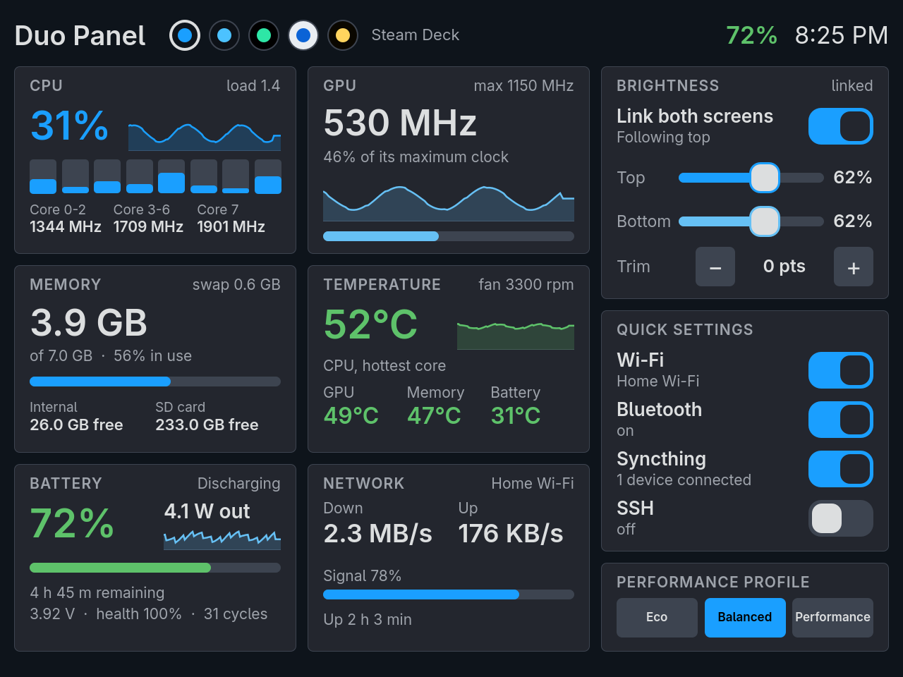
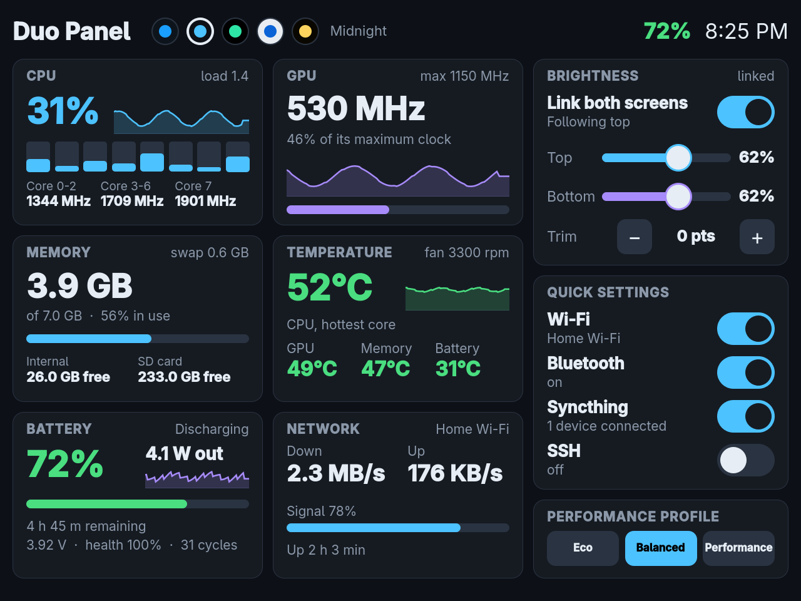
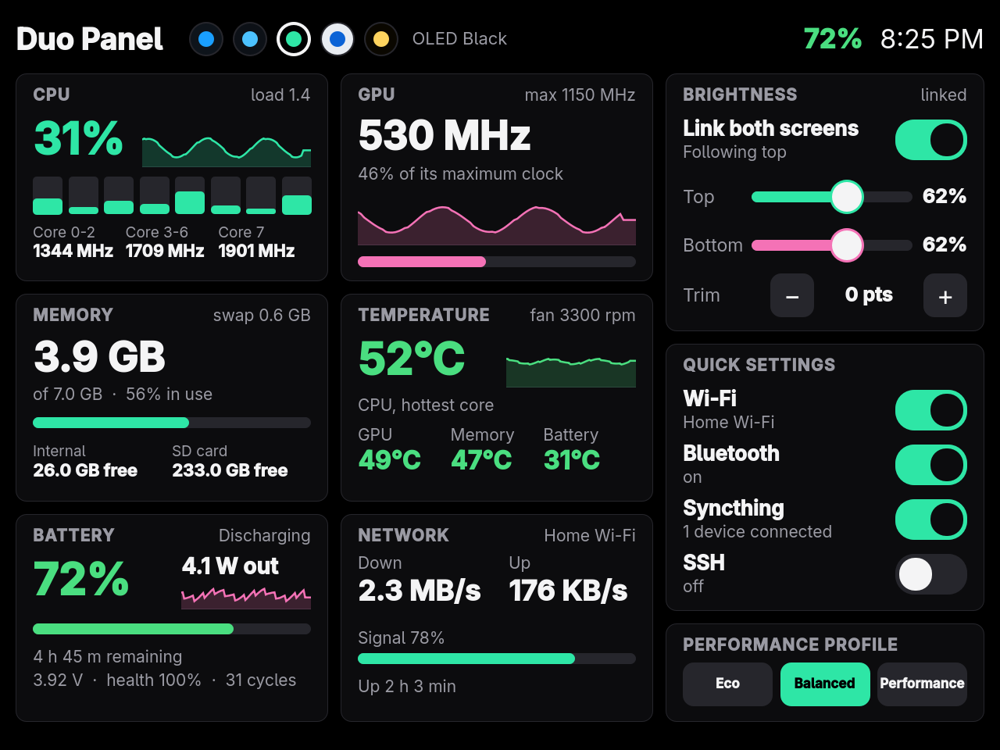
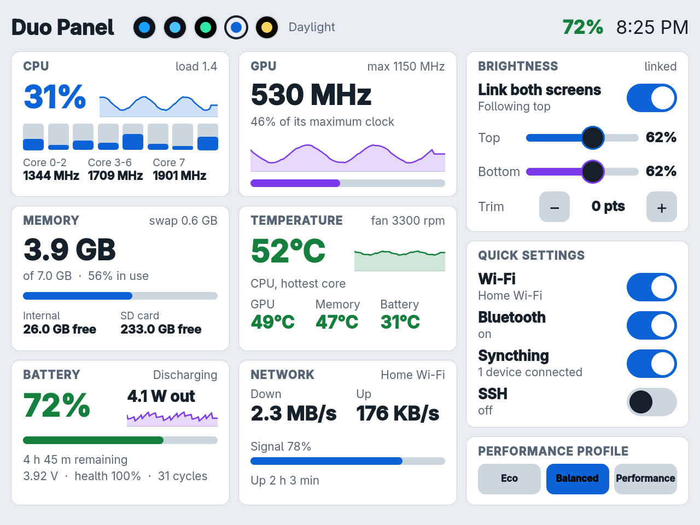
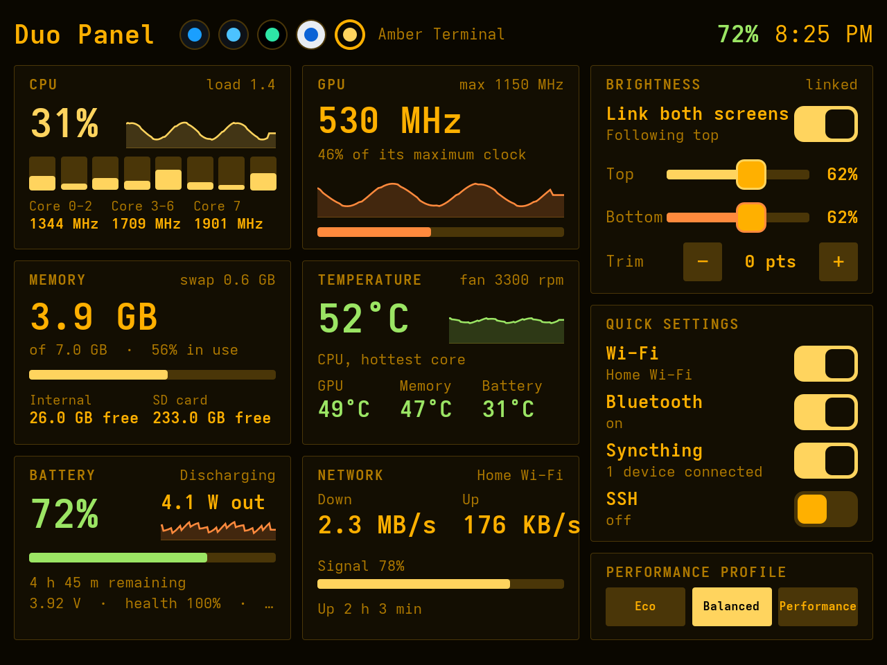

# Duo Panel

A bottom-screen dashboard for the **Retroid Pocket Duo** running [ArmadaOS](https://armadaos.dev), plus a small root service that keeps the two screens' brightness linked no matter which one you change or how (Steam's slider, Plasma, or the panel itself).



## What it does
- **Stats:** CPU (total, per core, per cluster clocks), GPU clock, memory and swap, temperatures, fan, battery (watts, time left, health), network speed and signal, free space on internal storage and the SD card. Read straight from `/proc` and `/sys`, no extra packages.
- **Quick settings:** Wi-Fi, Bluetooth, Syncthing and SSH switches, and an Eco / Balanced / Performance profile. Switching SSH off asks for a second tap, because it cuts remote access.
- **Linked brightness:** one switch links the screens. Whichever panel changed last becomes the source and the other follows by fraction of its own range, with an optional trim. A coarse-rounding test guards against the two screens chasing each other.
- **Themes:** Steam Deck (palette read from the Steam client's own CSS), Midnight, OLED Black, Daylight, Amber Terminal. The choice is saved in `~/.config/duo-panel/ui.json`.

| Midnight | OLED | Daylight | Amber |
|---|---|---|---|
|  |  |  |  |

## Install (on the Duo, over SSH or Konsole)
```
git clone <this repo> && cd duo-panel
bash deploy/install-user.sh              # the app, launcher entry and icon (no root)
sudo bash deploy/install-root.sh         # the brightness service (needs the device password)
```
Open **Duo Panel** from the bottom screen's app drawer. The page is laid out for 1280x960 and scales to fit the window. Only one copy runs at a time.

Without the root service the panel still works; the brightness card then shows "service off".

## How the brightness link works
Armada's `armada-control` rewrites the bottom backlight every 2 seconds from `/etc/armada/bottom-screen-brightness`, so a plain sysfs write is undone. `duo-panel-sync.service` (root, sandboxed with `ProtectSystem=strict`) watches both `/sys/class/backlight/*` devices, writes the follower panel, and updates Armada's saved value to match.
- Control socket `/run/duo-panel/control.sock` (group `armada`), state `/run/duo-panel/state.json`, config `/var/lib/duo-panel/config.json` (`locked`, `trim`).
- CLI: `python3 -m duo_panel.ctl get | lock on|off | trim N | set top|bottom PCT` (from `/var/lib/duo-panel`).
- A copy of Armada's original saved value is kept in `/var/lib/duo-panel/bottom-screen-brightness.before`.

## Remove
```
bash deploy/uninstall-user.sh
sudo bash /var/lib/duo-panel/uninstall-root.sh        # add --keep-brightness to keep the current bottom level
```

## Develop
```
python3 -W error::ResourceWarning -m unittest discover -s tests        # runs anywhere, no Qt needed
DUO=armada@<duo-ip> deploy/shot.sh out.png --theme steamdeck [--demo fixtures/demo.json]
```
`shot.sh` renders on the Duo with Qt's offscreen platform, so nothing appears on either screen. The UI is PySide6 / QML (PySide6 ships with ArmadaOS).

## Hardware notes (verified on a Duo)
Top backlight `ae94000.dsi.0` (max 4095), bottom `ae96000.dsi.0` (max 3445), connectors DSI-1 and DSI-2. The Steam Deck palette values come from `~/.local/share/Steam/steamui/css/sp.css` on the device.

## License
MIT
